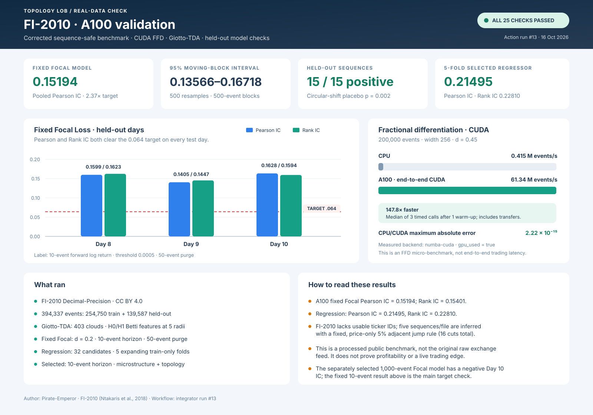
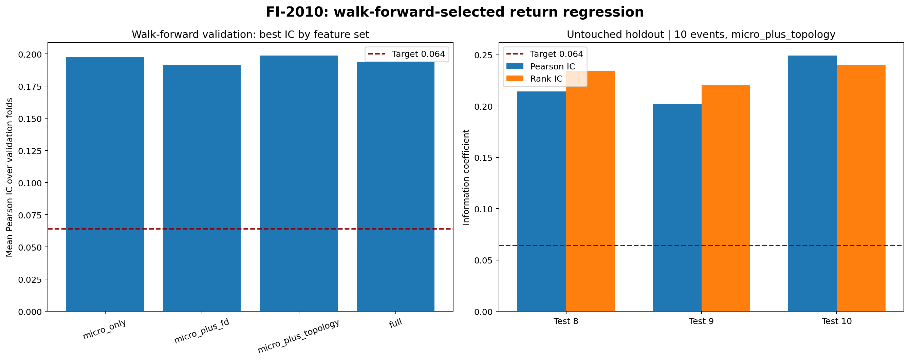

# Topology LOB

A reproducible research pipeline for Level-2 limit-order-book data. It combines microstructure features, topological data analysis, fractional differentiation, and XGBoost to study short-horizon price changes.

## Current benchmark result

The corrected FI-2010 experiment on the A100 runner measured **0.151939 pooled Pearson IC** for the fixed custom Focal Loss model, above the stated **0.064** target. Each of the three held-out files also exceeded 0.064 for Pearson IC and Rank IC.

This is a result on FI-2010 Decimal-Precision, a licensed but preprocessed public benchmark. It is not the original timestamped exchange feed and does not prove profitability. See the limitations and sequence-boundary rule below before interpreting the numbers.

## What the pipeline does

1. Checks L2 snapshots, timestamps, prices, and order sizes.
2. Builds spread, imbalance, microprice, order-flow, and volatility features.
3. Converts each order book into a normalized liquidity point cloud.
4. Computes H0/H1 persistent-homology and Betti-count features with Giotto-TDA.
5. Selects fractional-differencing order on training data, then applies the filter causally on CPU or CUDA.
6. Trains a custom binary Focal Loss XGBoost model and standard log-loss controls.
7. Scores chronological held-out data after a purge gap; reports Pearson IC, Rank IC, ROC-AUC, PR-AUC, and log loss.

## FI-2010 A100 results

The A100 workflow downloaded the FI-2010 Decimal-Precision files under the dataset's **CC BY 4.0** terms, checked the files, ran CUDA fractional differentiation and Giotto-TDA, completed the fixed Focal benchmark and additional model searches, and uploaded its full experiment bundle. [Workflow run #13](https://github.com/SpryzenHell/integrator/actions/runs/38866278328) completed all 25 steps successfully. The input includes 394,337 events: 254,750 training events and 139,587 events across the three held-out files.

### Fixed custom Focal Loss model

| Held-out file | Rows | Pearson IC | Rank IC | ROC-AUC | PR-AUC | Log loss |
|---|---:|---:|---:|---:|---:|---:|
| Day 8 | 54,153 | 0.159861 | 0.162348 | 0.716959 | 0.242247 | 0.631763 |
| Day 9 | 50,847 | 0.140476 | 0.144745 | 0.694573 | 0.224194 | 0.643348 |
| Day 10 | 30,612 | 0.162768 | 0.159412 | 0.707603 | 0.249820 | 0.634142 |
| **Pooled Pearson IC** | **135,612** | **0.151939** | — | — | — | — |

Other measured scores for this A100 run:

| Metric | Result |
|---|---:|
| Pooled margin Pearson IC | 0.151199 |
| Pooled margin Rank IC | 0.154008 |
| Target | 0.064 |
| Pooled Pearson IC / target | 2.37× |
| Topology point clouds | 403 |
| TDA backend | Giotto-TDA |
| FFD backend | numba-cuda |
| Selected FFD order for fixed Focal model | d = 0.2 |
| Forward-return horizon | 10 events |
| Label threshold | 0.0005 |
| Purge gap | 50 events |

The table distinguishes the pooled margin-based rank measure from the per-day Rank IC values. The earlier corrected CPU reference report recorded pooled margin Rank IC 0.154200. The A100 figure above comes from A100 run #13; the independent CPU replay is recorded separately below. Small score differences between runs are kept visible rather than blended into one number.

### Robustness checks

- All **15 of 15** inferred held-out sequences had positive Pearson IC; mean sequence IC was 0.215726 and median was 0.218067.
- A moving-block bootstrap with 500 resamples and 500-event blocks gave a **95% interval of 0.135663–0.167179** for pooled Pearson IC.
- A 499-replicate, within-sequence circular-shift placebo gave **two-sided p = 0.002**; the 95th percentile of the null absolute IC was 0.013229.
- A separate training-only Focal horizon search selected 1,000 events. Its pooled Pearson IC was 0.066806 and Rank IC was 0.097197, but Day 10 was negative on both measures. It is less stable; the fixed 10-event model above is the main target check.

These checks support a non-zero score/return relationship on this benchmark. They do not establish trading profitability.

### GPU fractional differentiation

The dedicated A100 micro-benchmark processed 200,000 events with width 256 and d = 0.45. CUDA timing includes data transfers.

| Measure | CPU | A100 CUDA |
|---|---:|---:|
| Elapsed time | 0.481428 s | 0.003257 s |
| Throughput | 0.415 million events/s | 61.34 million events/s |

The measured speedup was **147.83×**. The maximum absolute CPU/CUDA difference was **2.22 × 10⁻¹⁵**. There was one warm-up and three timed CUDA calls. This is an FFD micro-benchmark, not end-to-end trading latency.

### Separate continuous-return XGBoost model

This is a different objective from the custom Focal Loss classifier. The training-only search considered **32 candidates** over **five expanding chronological folds** within the training file; the held-out files were not used to select the model.

| Metric | Result |
|---|---:|
| Selected horizon | 10 events |
| Selected features | 20 microstructure + topology features |
| Mean validation Pearson IC | 0.198856 ± 0.075433 |
| Mean validation Rank IC | 0.248313 ± 0.028288 |
| Validation folds with positive Pearson IC | 5 / 5 |
| Held-out Pearson IC | 0.214955 |
| Held-out Rank IC | 0.228103 |
| Held-out direction hit rate | 0.571741 |

| Held-out file | Rows | Pearson IC | Rank IC |
|---|---:|---:|---:|
| Day 8 | 55,178 | 0.214325 | 0.234260 |
| Day 9 | 51,872 | 0.201933 | 0.220425 |
| Day 10 | 31,637 | 0.249459 | 0.240102 |

Do not present these regression metrics as the Focal Loss result: the model objective is different.

A separate fixed 32-configuration horizon/feature sweep observed a held-out Pearson IC of 0.237371 and Rank IC of 0.232550 for the 10-event microstructure-plus-FFD candidate. This is a descriptive-only test-set comparison, not a model-selection score; choosing a winner from this table would use held-out outcomes. The headline regressor above was selected using training-only walk-forward folds.

## Additional experiments and controls

### Feature ablation

These are results from the independent CPU FI-2010 benchmark run. They show that the topology features help one tested configuration, while adding every feature does not improve every metric.

| Feature set | Pearson IC | Rank IC | ROC-AUC |
|---|---:|---:|---:|
| Microstructure only | 0.165493 | 0.170511 | 0.704764 |
| Microstructure + FFD | 0.149409 | 0.151836 | 0.706669 |
| Microstructure + topology | 0.167184 | 0.172098 | 0.702709 |
| Full feature stack | 0.150447 | 0.152992 | 0.706917 |

### Objective and threshold control

A separate A100 training-only threshold/objective sweep selected standard log-loss with a return threshold of 0.0001. Its held-out Pearson IC was 0.196630 and Rank IC was 0.202747. This is a separate control, not the fixed custom Focal Loss result. The earlier CPU reference sweep selected standard log-loss with a zero return threshold and measured held-out Pearson IC 0.195903 and Rank IC 0.202290.

### Stationarity and sequence-boundary checks

The fixed Focal experiment selected d = 0.2 using training-only stationarity checks: the median ADF p-value was 0.015357, all 5 of 5 tested training prefixes were below 0.05, and correlation with the original price series was 0.995689. A separate training-prefix sweep selected d = 0.3 by median ADF p-value (0.002453; 5 of 5 prefixes below 0.05) with price correlation 0.979516. This shows the trade-off between stationarity and retaining the original price series. FI-2010 has no usable ticker IDs or exchange timestamps. The pipeline therefore uses a fixed, price-only **5% adjacent mid-price jump rule** to infer five sequences per file and 16 cuts total. Features and forward-return labels restart at those boundaries, with a purge gap at sequence edges. These are inferred boundaries, not source-provided stock IDs.

### Independent CPU replay

The independent [CPU replay run #169](https://github.com/SpryzenHell/topology_lob/actions/runs/38873894177) passed all 23 workflow steps, including data/license checks, TDA, ablations, IC/objective sweeps, model selection, and result checks. It reproduced the main Focal Pearson IC and selected return-regression IC values to the recorded precision. It used CPU FFD, so it is not a second A100 throughput measurement. [CPU replay artifact 12035175429](https://github.com/SpryzenHell/topology_lob/actions/runs/38873894177/artifacts/12035175429).

## CI and test results

The latest full supported-environment CI run [#199](https://github.com/SpryzenHell/topology_lob/actions/runs/38883483918) passed:

- **56 Python tests** (13 non-blocking library warnings).
- Package build and a synthetic end-to-end demo requiring Giotto-TDA.
- Extended experiment generation and result validation: five ablation variants, six synthetic seeds, five chronological walk-forward folds, and a label-permutation placebo.
- Focal Loss gradient and Hessian finite-difference checks, malformed-book rejection, common-price translation invariance, and causal fractional-differentiation prefix checks.
- C++ CPU build and benchmark; the 200,000-event benchmark measured about **5.24 million events/s** on this run (hosted-runner timings vary).
- Raster image and SVG dashboard checks, including dimensions, readable labels, report titles and descriptions, and working README image links.

The CI synthetic result uses 6,000 generated L2 events, a 20-event purge gap, and 5,735 model rows. It measured Pearson IC 0.073292 for Focal Loss and 0.095368 for standard log-loss. These are engineering checks on synthetic data, not market results.

[Full CI validation record](results/CI_VALIDATION.md) · [Latest CI artifact 12038625972](https://github.com/SpryzenHell/topology_lob/actions/runs/38883483918/artifacts/12038625972) · [A100 validation report](results/A100_VALIDATION.md) · [Resume-target validation](results/RESUME_TARGET_VALIDATION.md) · [FI-2010 details](results/FI2010_VALIDATION.md) · [Price-boundary diagnostics](results/FI2010_BOUNDARY_DIAGNOSTICS.md) · [Machine-readable A100 summary](results/a100_fi2010_validation_summary.json).

## Dataset and source

The benchmark is **FI-2010 Decimal-Precision**, licensed under **Creative Commons Attribution 4.0 (CC BY 4.0)**. Credit Ntakaris et al. (2018), *Journal of Forecasting* 37(8), 852–866, [DOI 10.1002/for.2543](https://doi.org/10.1002/for.2543), and link the [official FI-2010 data record](https://etsin.fairdata.fi/dataset/73eb48d7-4dbc-4a10-a52a-da745b47a649) when sharing results.

The benchmark is preprocessed and does not expose usable ticker IDs or exchange timestamps. The 5% split is an assumption to avoid making returns across apparent price-scale changes. Use raw, timestamped L2 data with security IDs for claims about the original raw-feed setup. No pretrained model is required; the XGBoost models are trained on the benchmark.

## Quick start

Python 3.11 is recommended.

~~~bash
python3.11 -m venv .venv
source .venv/bin/activate
python -m pip install --upgrade pip
python -m pip install -e ".[tda,dev]"
python -m pytest -q
~~~

Run the deterministic demo with the full Giotto-TDA backend:

~~~bash
python run.py demo --config configs/demo.json --out results/demo --require-gtda
~~~

Outputs include metrics.json, test_scores.csv, Betti curves, a fractional-stationarity plot, and index.html. Add --require-cuda to require CUDA fractional differentiation; the command exits rather than silently falling back to CPU.

Run extended experiments and the C++ benchmark:

~~~bash
python scripts/generate_evidence.py --events 6000 --out results/evidence --require-gtda
python run.py ablation --config configs/demo.json --out results/ablation
python run.py walk-forward --config configs/demo.json --out results/walk_forward.json
python run.py ffd-benchmark --events 200000 --width 256 --d 0.45
cmake -S . -B build
cmake --build build --config Release
./build/fractional_diff_cpu
~~~

## Run FI-2010

The fetch script downloads the public Decimal-Precision files locally; raw dataset files are not committed.

~~~bash
python scripts/fetch_fi2010.py --out data/external/fi2010.zip --extract
python scripts/run_fi2010_benchmark.py --train data/external/fi2010/Train_Dst_NoAuction_DecPre_CF_7.txt --test data/external/fi2010/Test_Dst_NoAuction_DecPre_CF_7.txt data/external/fi2010/Test_Dst_NoAuction_DecPre_CF_8.txt data/external/fi2010/Test_Dst_NoAuction_DecPre_CF_9.txt --tda-stride 1000 --require-gtda --out results/fi2010_benchmark.json
~~~

On a supported CUDA system, add --require-cuda. A result counts as GPU evidence only when it reports gpu_used=true and backend numba-cuda. Review the official dataset terms before redistributing the data.

## Real L2 input

The CSV loader expects one row per snapshot and columns for timestamp plus every book level:

~~~text
timestamp,bid_price_1,bid_size_1,ask_price_1,ask_size_1,...,bid_price_N,bid_size_N,ask_price_N,ask_size_N
~~~

It sorts by timestamp and rejects duplicate or invalid timestamps, missing or non-finite values, negative sizes, invalid prices, and crossed, locked, or incorrectly ordered books.

~~~bash
python run.py demo --config configs/demo.json --data /absolute/path/to/l2.csv --out results/real_l2 --require-gtda
~~~

Use correctly timestamped raw L2 data for results intended to represent a live exchange feed.

## Figures and reports

These figures show model results and data checks, not terminal captures.

- [A100 FI-2010 validation dashboard](assets/figures/a100_fi2010_validation_dashboard.svg)
- [Synthetic experiment dashboard](assets/figures/experimental_validation_dashboard.png)
- [Robustness checks](assets/figures/robustness_dashboard.png)
- [Data diagnostics](assets/figures/data_diagnostics_dashboard.png)
- [CPU FI-2010 results](assets/figures/fi2010_validation_dashboard.png)
- [Return-regression selection](assets/figures/fi2010_return_regression_selection.png)
- [Readable report preview](assets/screenshots/report_preview.png)
- [Figure notes](assets/README.md)

The A100 dashboard uses high-contrast text and a fixed canvas; CI checks the SVG size, required labels, title/description, and image links. The incomplete main.png banner is intentionally removed. Only one code-license file, LICENSE, is kept.

## Author

**Pirate-Emperor**

## License

The project code is released under the MIT License; see [LICENSE](LICENSE). Dataset terms are separate from the code license.
