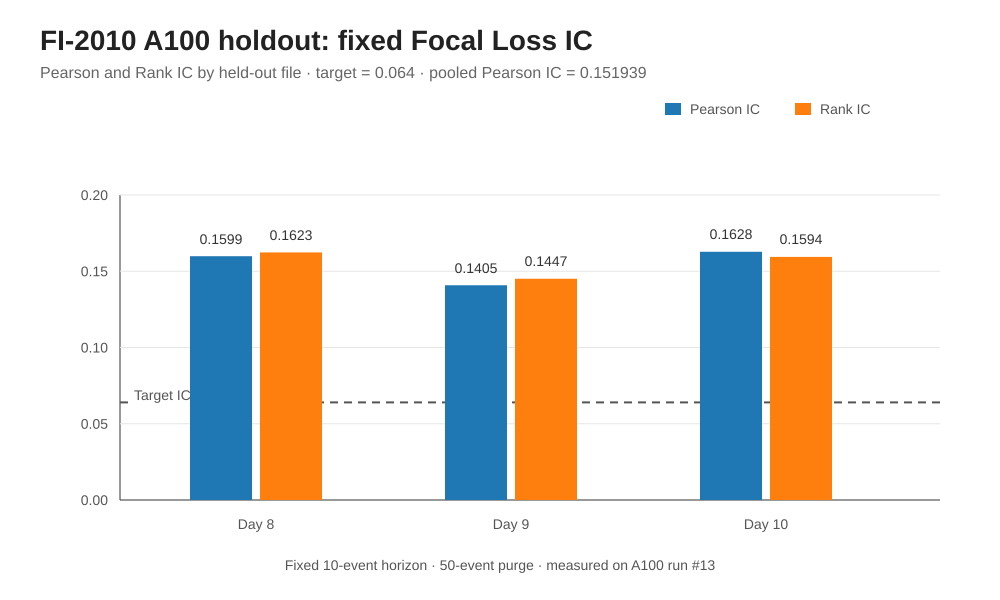

# Topology LOB

Topology LOB is a research pipeline for high-frequency Level-2 (L2) limit-order-book data. It combines microstructure features, topological data analysis (TDA), fractional differentiation, and XGBoost models to study short-horizon returns.

The project focuses on three goals:

1. **Liquidity structure:** use Betti numbers and persistent homology to describe the shape of liquidity across book levels.
2. **Stationarity:** apply fractional differentiation causally, including a CUDA implementation for accelerated processing.
3. **Prediction:** evaluate a custom Focal Loss classifier out of sample and compare it with standard log-loss and continuous-return regression controls.

The current evidence is based on the public FI-2010 Decimal-Precision benchmark. The fixed custom Focal Loss model measured **0.151939 pooled Pearson IC**, compared with the target of **0.064**. This clears the numerical target on this benchmark; it does not prove trading profitability or establish the same result on an original raw exchange feed.



*Measured values from A100 workflow run #13. The plot uses the same white background, blue/orange series, grey grid, and plain labels as the other figures in this repository. CPU/A100 throughput is kept in the performance section below rather than mixed into the IC chart.*

## Contents

- [At a glance](#at-a-glance)
- [Measured results](#measured-results)
- [Project goals](#project-goals)
- [Pipeline and design](#pipeline-and-design)
- [Dataset, license, and boundaries](#dataset-license-and-boundaries)
- [Experiments and controls](#experiments-and-controls)
- [Validation and test coverage](#validation-and-test-coverage)
- [Quick start](#quick-start)
- [Reproduce the FI-2010 experiment](#reproduce-the-fi-2010-experiment)
- [Run with a real L2 feed](#run-with-a-real-l2-feed)
- [Code and output map](#code-and-output-map)
- [Figures and reports](#figures-and-reports)
- [Limits and interpretation](#limits-and-interpretation)
- [Citation and license](#citation-and-license)

## At a glance

| Item | Details |
|---|---|
| Main language | Python |
| Performance component | C++ fractional-differentiation implementation |
| Model | XGBoost |
| Topology library | Giotto-TDA |
| GPU FFD backend | Numba CUDA |
| Main public benchmark | FI-2010 Decimal-Precision |
| Dataset license | CC BY 4.0; code license is separate |
| Test environment | Python 3.11 |
| Main result report | [A100 validation report](results/A100_VALIDATION.md) |
| Detailed goal-by-goal report | [Resume-target validation](results/RESUME_TARGET_VALIDATION.md) |

## Measured results

### Fixed custom Focal Loss classifier — A100 run

This is the primary result for the stated IC target. The model configuration was fixed before scoring the held-out files: custom binary Focal Loss, a 10-event forward-return horizon, a 0.0005 label threshold, a 50-event purge gap, and fractional-differencing order (d=0.2) selected from training data only.

| Held-out file | Scored rows | Pearson IC | Rank IC | ROC-AUC |
|---|---:|---:|---:|---:|
| Day 8 | 54,153 | 0.159861 | 0.162348 | 0.716959 |
| Day 9 | 50,847 | 0.140476 | 0.144745 | 0.694573 |
| Day 10 | 30,612 | 0.162768 | 0.159412 | 0.707603 |
| **Pooled probability Pearson IC** | **135,612** | **0.151939** | — | — |

| Additional A100 measure | Measured result |
|---|---:|
| Pooled margin Pearson IC | 0.151199 |
| Pooled margin Rank IC | 0.154008 |
| IC target | 0.064 |
| Pooled Pearson IC divided by target | 2.37× |
| TDA point clouds evaluated | 403 |
| Homology dimensions | H0 and H1 |
| Betti radii | 0.5, 1.0, 1.5, 2.0, 2.5 |
| FFD backend | `numba-cuda` |
| TDA backend | `giotto-tda` |

**Metric note:** the daily Rank IC values above are computed per held-out file. The pooled margin Rank IC is a separate calculation using the model margin, so the values should not be treated as interchangeable. The earlier CPU reference reported pooled margin Rank IC 0.154200; the A100 measurement reported 0.154008.

The A100 workflow completed all 25 steps and checked that the GPU backend was actually used. See [workflow run #13](https://github.com/SpryzenHell/integrator/actions/runs/38866278328) and its [full experiment bundle](https://github.com/SpryzenHell/integrator/actions/runs/38866278328/artifacts/12032068300).

### Separate continuous-return regression

This XGBoost regressor predicts continuous forward returns. It has a different objective from the binary Focal Loss classifier, so these numbers are reported separately and are **not** substituted for the custom Focal result.

The selector considered 32 candidates and used five expanding chronological validation folds entirely inside the training data. The final model used a 10-event horizon, 20 microstructure-plus-topology features, and (d=0.3).

| Metric | Result |
|---|---:|
| Mean validation Pearson IC | 0.198856 ± 0.075433 |
| Mean validation Rank IC | 0.248313 ± 0.028288 |
| Folds with positive validation Pearson IC | 5 / 5 |
| Held-out rows | 138,687 |
| **Held-out Pearson IC** | **0.214955** |
| **Held-out Rank IC** | **0.228103** |
| Held-out direction hit rate | 0.571741 |

| Held-out file | Rows | Pearson IC | Rank IC |
|---|---:|---:|---:|
| Day 8 | 55,178 | 0.214325 | 0.234260 |
| Day 9 | 51,872 | 0.201933 | 0.220425 |
| Day 10 | 31,637 | 0.249459 | 0.240102 |

### GPU fractional-differentiation benchmark

The dedicated A100 test processed 200,000 events with width 256 and (d=0.45). The CUDA timing includes host/device data transfers.

| Measure | CPU | A100 CUDA |
|---|---:|---:|
| Elapsed time | 0.481428 s | 0.003257 s |
| Throughput | 0.415 million events/s | 61.34 million events/s |

- **Measured speedup:** 147.83×.
- **Maximum absolute CPU/CUDA difference:** (2.22\times 10^{-15}).
- **Timing method:** one warm-up and three timed CUDA calls, reporting the CUDA median.
- **Scope:** this is an FFD micro-benchmark, not full-pipeline latency or trading execution speed.

The run checked both `gpu_used=true` and the `numba-cuda` backend. CPU fallback is not accepted as proof of GPU performance.

## Project goals

### 1. Find liquidity structure with topological data analysis

A single order-book snapshot can contain gaps, dense areas, and disconnected regions across price and size levels. The code maps book state into a normalized point cloud and uses persistent homology to measure its shape. It extracts H0/H1 information and Betti counts across five radii. These values add a description of the structure of the book to more direct features such as spread and imbalance.

This benchmark confirms that the TDA path runs and produces features. The ablation results below show that adding topology does not improve every metric in every configuration, so the README does not claim that the full feature set is always best.

### 2. Apply fractional differentiation without future leakage

Fractional differentiation seeks a useful balance between reducing slow trends and retaining information in the original price series. The candidate order is selected on training prefixes. The filter itself is applied causally: a value at time (t) must not depend on observations after (t).

The implementation provides a CPU path and a Numba CUDA path. The A100 workflow compares their numerical output before running the real-data experiment. A run counts as GPU evidence only when the metadata confirms CUDA use.

### 3. Test the custom Focal Loss objective out of sample

The fixed binary classifier is scored on three chronological FI-2010 held-out files. Pearson IC measures the linear association between the prediction score and continuous forward return. Rank IC measures their rank association. ROC-AUC, precision-recall AUC, and log loss are also tracked where those values were recorded.

The IC threshold of 0.064 is treated as a target, not as an input value, a default, or a value filled into missing results.

## Pipeline and design

The main processing path is:

1. **Read and validate the data.** Check ordering, prices, sizes, missing values, timestamps/event order, and book consistency.
2. **Create microstructure features.** Build spread, imbalance, microprice, order-flow, and volatility-related features.
3. **Build liquidity point clouds.** Convert a book snapshot to a normalized representation suitable for topology calculations.
4. **Extract topology.** Run Giotto-TDA for H0/H1 and Betti counts at the configured radii.
5. **Choose and apply fractional differentiation.** Select (d) using training-only stationarity checks and filter the series causally.
6. **Create forward-return labels.** Calculate targets within each permitted sequence, using a fixed horizon, threshold, and purge gap.
7. **Fit comparison models.** Train the custom Focal Loss classifier and comparison models with clearly separated objectives.
8. **Evaluate the holdout.** Report per-file and pooled scores. Do not use held-out outcomes to choose a configuration.
9. **Save evidence.** Store machine-readable JSON, a readable plot, and Markdown records so the result can be checked later.

### Why sequence boundaries matter

The FI-2010 Decimal-Precision files do not expose usable ticker IDs or exchange timestamps. A diagnostic found four adjacent mid-price jumps above 5% in each of the four files (one training file plus three test files). The pipeline applies a fixed, price-only 5% jump rule to infer five sequences in each file, giving 16 cuts total. Feature windows and forward-return labels restart at those boundaries, and purge gaps are applied at sequence edges.

This is a transparent workaround, **not confirmed security metadata**. It reduces obviously invalid returns across large price-scale changes, but the inferred sequence assignments must be checked against a source with known security IDs before claiming exact raw-feed replication.

## Dataset, license, and boundaries

The benchmark is **FI-2010 Decimal-Precision**. Its published files contain 254,750 training events and three held-out files containing 55,478, 52,172, and 31,937 events, respectively, for 394,337 events in total.

| Split | File | Events |
|---|---|---:|
| Training | `Train_Dst_NoAuction_DecPre_CF_7.txt` | 254,750 |
| Held out — day 8 | `Test_Dst_NoAuction_DecPre_CF_7.txt` | 55,478 |
| Held out — day 9 | `Test_Dst_NoAuction_DecPre_CF_8.txt` | 52,172 |
| Held out — day 10 | `Test_Dst_NoAuction_DecPre_CF_9.txt` | 31,937 |
| **Total** | | **394,337** |

The benchmark is preprocessed and normalized. It provides event ordering rather than usable exchange wall-clock timestamps and does not expose usable ticker IDs in these files. Consequently:

- Use the published event order for chronology within each file.
- Do not create forward-return labels that cross a file boundary.
- The price-jump sequence split is a heuristic and remains a study limitation.
- This benchmark is suitable for a reproducible public-data check, but it is not the original raw timestamped exchange feed.

### License and credit

The FI-2010 dataset is listed under **Creative Commons Attribution 4.0 International (CC BY 4.0)**. When reporting or sharing results, credit Ntakaris et al. (2018), *Journal of Forecasting* 37(8), 852–866, [DOI 10.1002/for.2543](https://doi.org/10.1002/for.2543), and link the [official FI-2010 data record](https://etsin.fairdata.fi/dataset/73eb48d7-4dbc-4a10-a52a-da745b47a649).

Dataset terms are separate from the repository's MIT code license. The scripts keep downloaded data out of the Git repository and record checksums in the experiment manifest.

## Experiments and controls

### Feature ablation — CPU reference run

These ablation results are from the independent CPU FI-2010 reference experiment. The goal is to check what each feature group contributes, not to assume the full stack always wins.

| Feature set | Pearson IC | Rank IC | ROC-AUC |
|---|---:|---:|---:|
| Microstructure only | 0.165493 | 0.170511 | 0.704764 |
| Microstructure + FFD | 0.149409 | 0.151836 | 0.706669 |
| Microstructure + topology | 0.167184 | 0.172098 | 0.702709 |
| Full feature stack | 0.150447 | 0.152992 | 0.706917 |

In this run, microstructure plus topology gave the highest Pearson and Rank IC among these four listed variants. The full feature stack did not, and the ROC-AUC ranking differed. These results show why feature groups should be measured rather than assumed to help.

### Threshold and objective comparison

The real-data workflow compares the fixed Focal model with standard log-loss under a threshold/objective search whose configuration is chosen using an internal training validation split. The A100 run selected standard log-loss with a 0.0001 return threshold; its held-out Pearson IC was 0.196630 and Rank IC was 0.202747. This is a separate control model, not the fixed Focal result.

An earlier CPU reference sweep selected standard log-loss at a zero return threshold and measured held-out Pearson IC 0.195903 and Rank IC 0.202290. The threshold and scores differ slightly between these recorded runs; the values are kept attached to their respective run rather than averaged.

### Focal horizon search

A separate search compared 10, 20, 30, 50, 100, 200, 500, and 1,000 event horizons using training-only selection. The A100 search selected a 1,000-event horizon and reported pooled Pearson IC 0.066806 and Rank IC 0.097197. Day 10 was negative for both measures (Pearson −0.045135 and Rank −0.042798). That secondary result is less stable across held-out files, so the fixed 10-event result remains the primary check of the 0.064 target.

### Walk-forward return-regression selection

The continuous-return selection script evaluates 32 candidate combinations with five expanding chronological folds inside the training file. The held-out files are scored only after selection and refitting. The saved output contains the chosen horizon, feature set, validation scores, per-day holdout values, and dataset hash details.

A separate fixed 32-configuration sweep also contains descriptive results for configurations evaluated on the held-out files. Those rows should not be used to choose the final model: selecting a winner by test score would turn the holdout into training data. The headline regression numbers reported above are from training-only walk-forward selection.

### Stationarity order check

The fixed Focal run selected (d=0.2): the median ADF p-value was 0.015357, all five tested training prefixes were below 0.05, and the correlation with the original price series was 0.995689. A separate training-prefix order sweep selected (d=0.3) by median ADF p-value (0.002453, with all five prefixes below 0.05) but reduced correlation with the original price series to 0.979516. This is the stationarity-versus-information-retention trade-off, not evidence that one order is universally best.

### Robustness on the fixed A100 Focal result

| Check | Recorded result |
|---|---:|
| Inferred held-out sequences with positive Pearson IC | 15 / 15 |
| Mean sequence Pearson IC | 0.215726 |
| Median sequence Pearson IC | 0.218067 |
| Moving-block bootstrap replicates | 500 |
| Block length | 500 events |
| 95% bootstrap interval for pooled Pearson IC | [0.135663, 0.167179] |
| Circular-shift placebo replicates | 499 |
| Two-sided circular-shift p-value | 0.002 |
| 95th percentile of null absolute IC | 0.013229 |

The sequence-level averages are not the same statistic as the pooled IC: the average of within-sequence correlations and the correlation over all pooled rows have different weighting. Both are recorded to make that distinction clear. The placebo and bootstrap results support a non-zero association in this benchmark but do not establish future profitability.

### CPU replay consistency

Two separate CPU FI-2010 workflow runs completed successfully:

- [Run #169](https://github.com/SpryzenHell/topology_lob/actions/runs/38873894177), artifact [12035175429](https://github.com/SpryzenHell/topology_lob/actions/runs/38873894177/artifacts/12035175429).
- [Run #170](https://github.com/SpryzenHell/topology_lob/actions/runs/38883483885), artifact [12039460485](https://github.com/SpryzenHell/topology_lob/actions/runs/38883483885/artifacts/12039460485).

The later replay passed the data checks, TDA benchmark, ablation, objective/threshold sweep, multi-horizon regression coverage, training-only Focal horizon selection, five-fold return-regression selection, result validation, artifact upload, and result publication. It reproduced the fixed Focal pooled Pearson IC (0.151939) and selected regression scores (0.214955 Pearson / 0.228103 Rank) to the recorded precision. The CPU runs used CPU FFD and are not GPU throughput tests.

## Validation and test coverage

The latest full CI run, [run #208](https://github.com/SpryzenHell/topology_lob/actions/runs/38906104659), passed all three jobs. It validated the plain summary plot, expanded README, new plot/content checks, package build, extended experiment generation, C++ benchmark, and report-image refresh. The tested workflow commit was `a7811878632c62c75c25886a1e0a4a30667c293b`; the only subsequent code-tree change was a documentation wording correction for the actual CUDA CLI options.

Recorded CI results:

- **58 Python tests passed** in 3.86 seconds, with 13 non-blocking dependency warnings.
- Python package build and wheel/source archive check passed.
- Synthetic end-to-end demo with Giotto-TDA required and verified passed.
- Extended evidence generation and validation passed.
- C++ CPU build and benchmark passed.
- Image validation passed for the dashboard canvas, title, description, required labels, raster images, and local README image links.

The test suite covers malformed L2 input rejection, Focal Loss gradient and Hessian numerical checks, common-price translation invariance, causal fractional-differentiation prefix behaviour, timing validation, FI-2010 boundary handling, selector behaviour, required output files, author metadata, the removed `main.png`, and the single retained code-license file.

### Synthetic engineering experiment

The deterministic CI demo used 6,000 synthetic events, a chronological holdout, a 20-event purge gap, and 5,735 model rows (3,994 train and 1,721 test). It reported:

| Metric | Focal Loss | Log-loss control |
|---|---:|---:|
| Pearson IC | 0.073292 | 0.095368 |
| Rank IC | 0.039856 | 0.036762 |
| ROC-AUC | 0.531075 | 0.528676 |
| PR-AUC | 0.244568 | 0.242809 |
| Log loss | 0.516779 | 0.561761 |

The extended evidence run also used five ablation variants, six deterministic seeds, five chronological walk-forward folds, and a label-permutation placebo. The custom Focal gradient and Hessian were compared with finite differences; the measured absolute errors were approximately (7.41\times10^{-12}) and (1.06\times10^{-11}). Translation and causal-prefix checks had zero recorded error.

**These are engineering checks on synthetic data, not market results.** They must not be presented as evidence that the FI-2010 IC target has been met.

### C++ CPU benchmark

The latest recorded CI timing for 200,000 events at width 256 and (d=0.45) was 5.220 million events/s, with checksum 0.390931. An earlier hosted-runner result measured about 6.05 million events/s. Hosted CPU timing varies, and the C++ benchmark is not directly comparable to the Python/CUDA FFD result because the implementations and timing paths differ.

The latest CI evidence bundle is [artifact 12047459548](https://github.com/SpryzenHell/topology_lob/actions/runs/38906104659/artifacts/12047459548).

## Quick start

Python 3.11 is recommended.

### Create an environment and run tests

```bash
python3.11 -m venv .venv
source .venv/bin/activate
python -m pip install --upgrade pip
python -m pip install -e ".[tda,dev]"
python -m pytest -q
```

### Run the synthetic end-to-end demo

```bash
python run.py demo --config configs/demo.json --out results/demo --require-gtda
```

The output includes `metrics.json`, `test_scores.csv`, Betti curves, a fractional-stationarity plot, and `index.html`. Add `--require-cuda` on a supported CUDA machine to make the demo fail rather than silently falling back to CPU.

### Run extra experiments

```bash
python scripts/generate_evidence.py --events 6000 --out results/evidence --require-gtda
python run.py ablation --config configs/demo.json --out results/ablation
python run.py walk-forward --config configs/demo.json --out results/walk_forward.json
python run.py ffd-benchmark --events 200000 --width 256 --d 0.45
cmake -S . -B build -DCMAKE_BUILD_TYPE=Release
cmake --build build --config Release
./build/fractional_diff_cpu
```

The `ffd-benchmark` command records the backend it actually used but does not expose a separate `--require-cuda` switch. On a supported CUDA machine, run it and verify `gpu_used=true` and `backend=numba-cuda` in the resulting JSON; do not record a CPU fallback as a GPU result. The `demo` command does support `--require-cuda` and exits if CUDA was not used.

## Reproduce the FI-2010 experiment

### 1. Download and verify the dataset

```bash
python scripts/fetch_fi2010.py \
  --out data/external/fi2010.zip \
  --extract
```

The script prints a checksum. The workflow also records SHA-256 hashes and file sizes in `results/fi2010_data_manifest.json`. Avoid committing downloaded raw data into the repository.

### 2. Run the TDA/Focal benchmark

```bash
python scripts/run_fi2010_benchmark.py \
  --train data/external/fi2010/Train_Dst_NoAuction_DecPre_CF_7.txt \
  --test \
    data/external/fi2010/Test_Dst_NoAuction_DecPre_CF_7.txt \
    data/external/fi2010/Test_Dst_NoAuction_DecPre_CF_8.txt \
    data/external/fi2010/Test_Dst_NoAuction_DecPre_CF_9.txt \
  --tda-stride 1000 \
  --require-gtda \
  --out results/fi2010_benchmark.json
```

Add `--require-cuda` to require GPU fractional differentiation. On a supported A100 or other compatible CUDA system, the run should report `gpu_used=true` and `fractional_diff_backend=numba-cuda`. Without that flag, CPU fallback may be allowed; do not describe a CPU fallback as a GPU result.

### 3. Run ablation and objective/threshold checks

```bash
python scripts/run_fi2010_ablation.py \
  --train data/external/fi2010/Train_Dst_NoAuction_DecPre_CF_7.txt \
  --test \
    data/external/fi2010/Test_Dst_NoAuction_DecPre_CF_7.txt \
    data/external/fi2010/Test_Dst_NoAuction_DecPre_CF_8.txt \
    data/external/fi2010/Test_Dst_NoAuction_DecPre_CF_9.txt \
  --require-gtda --tda-stride 1000 \
  --out results/fi2010_ablation.json

python scripts/run_fi2010_ic_sweep.py \
  --train data/external/fi2010/Train_Dst_NoAuction_DecPre_CF_7.txt \
  --test \
    data/external/fi2010/Test_Dst_NoAuction_DecPre_CF_7.txt \
    data/external/fi2010/Test_Dst_NoAuction_DecPre_CF_8.txt \
    data/external/fi2010/Test_Dst_NoAuction_DecPre_CF_9.txt \
  --require-gtda --tda-stride 1000 \
  --out results/fi2010_ic_sweep.json
```

### 4. Run horizon search and walk-forward regression

```bash
python scripts/run_fi2010_focal_horizon_selection.py \
  --train data/external/fi2010/Train_Dst_NoAuction_DecPre_CF_7.txt \
  --test \
    data/external/fi2010/Test_Dst_NoAuction_DecPre_CF_7.txt \
    data/external/fi2010/Test_Dst_NoAuction_DecPre_CF_8.txt \
    data/external/fi2010/Test_Dst_NoAuction_DecPre_CF_9.txt \
  --horizons 10 20 30 50 100 200 500 1000 \
  --require-gtda --tda-stride 1000 \
  --out results/fi2010_focal_horizon_selection.json

python scripts/run_fi2010_return_regression_selection.py \
  --train data/external/fi2010/Train_Dst_NoAuction_DecPre_CF_7.txt \
  --test \
    data/external/fi2010/Test_Dst_NoAuction_DecPre_CF_7.txt \
    data/external/fi2010/Test_Dst_NoAuction_DecPre_CF_8.txt \
    data/external/fi2010/Test_Dst_NoAuction_DecPre_CF_9.txt \
  --horizons 10 20 30 50 100 200 500 1000 \
  --require-gtda --tda-stride 1000 \
  --out results/fi2010_return_regression_selection.json \
  --dashboard assets/figures/fi2010_return_regression_selection.png
```

The exact command-line options can evolve with the scripts; consult each script's `--help` output if an argument changes. For an archived result, keep the input manifest, configuration, model selection record, and final metrics together.

## Run with a real L2 feed

The CSV loader expects one row per snapshot and a timestamp plus price and size for each bid/ask level:

```text
timestamp,bid_price_1,bid_size_1,ask_price_1,ask_size_1,...,bid_price_N,bid_size_N,ask_price_N,ask_size_N
```

Example:

```bash
python run.py demo \
  --config configs/demo.json \
  --data /absolute/path/to/l2.csv \
  --out results/real_l2 \
  --require-gtda
```

The loader sorts by timestamp and rejects duplicate or invalid timestamps, missing or non-finite values, negative sizes, invalid prices, and crossed, locked, or incorrectly ordered books. Confirm that the feed's time zone, event ordering, security identifiers, and treatment of auctions match the experiment before interpreting the result.

For original-feed claims, keep separate securities and trading sessions correctly identified. Do not rely on the FI-2010 5% price-jump heuristic when true security IDs and timestamps are available.

## Code and output map

| Path | Purpose |
|---|---|
| `topology_lob.py` | Core feature building, point clouds, persistent features, Focal Loss, evaluation, and fractional differentiation |
| `fi2010.py` | FI-2010 raw-format loader and conversion to canonical book fields |
| `run.py` | Command-line entry point for the demo, ablation, walk-forward, and FFD benchmark |
| `cpp/fractional_diff.cpp` | Standalone C++ CPU fractional-differentiation benchmark |
| `configs/demo.json` | Settings for the deterministic synthetic example |
| `configs/fi2010.json` | FI-2010 experiment settings |
| `scripts/fetch_fi2010.py` | Dataset download and extraction |
| `scripts/diagnose_fi2010_boundaries.py` | Detect and report large adjacent mid-price jumps |
| `scripts/run_fi2010_benchmark.py` | Main real-data TDA and Focal Loss benchmark |
| `scripts/run_fi2010_ablation.py` | Compare feature groups |
| `scripts/run_fi2010_ic_sweep.py` | Compare thresholds and objectives with internal validation |
| `scripts/run_fi2010_focal_horizon_selection.py` | Training-only Focal horizon/feature selection |
| `scripts/run_fi2010_return_regression.py` | Multi-horizon continuous-return candidates |
| `scripts/run_fi2010_return_regression_selection.py` | Five-fold chronological selection and measured dashboard |
| `scripts/generate_evidence.py` | Synthetic numerical and data-quality stress tests |
| `scripts/validate_assets.py` | Validate result figures and report image references |
| `tests/` | Unit, integration, numerical, boundary, selection, timing and asset tests |
| `results/*.json` | Machine-readable metrics and diagnostics |
| `results/*.md` | Human-readable validation and experiment reports |

## Figures and reports

The first figure is a regular data plot in the same style as the other charts in this repository: white background, standard axes, grey grid lines, blue/orange series, and no decorative banner. The larger dashboard is retained as a secondary figure for readers who want more context.

- [Simple measured-data plot](assets/figures/benchmark_summary.svg)
- [Detailed A100 validation dashboard](assets/figures/a100_fi2010_validation_dashboard.svg)
- [CPU FI-2010 results](assets/figures/fi2010_validation_dashboard.png)
- [Walk-forward regression selection](assets/figures/fi2010_return_regression_selection.png)
- [Synthetic experiment dashboard](assets/figures/experimental_validation_dashboard.png)
- [Synthetic robustness checks](assets/figures/robustness_dashboard.png)
- [Data diagnostics](assets/figures/data_diagnostics_dashboard.png)
- [Report preview](assets/screenshots/report_preview.png)
- [Figure notes](assets/README.md)

The synthetic figures illustrate numerical and engineering checks; they are not FI-2010 model-performance figures. There is intentionally no `main.png` banner and no terminal screenshot.

## Limits and interpretation

The evidence supports a measured score/return relationship on the stated FI-2010 experiment. It does not by itself establish:

- profitability after fees, spread, market impact, and order execution;
- robustness to different instruments, venues, trading periods, or data vendors;
- exact reproduction of an experiment on the original timestamped raw L2 feed;
- correctness of the inferred FI-2010 stock boundaries;
- that every added feature improves every metric;
- that a micro-benchmark speedup equals full application or strategy speedup.

For credible follow-up work, use a raw feed with security IDs and timestamps, split by session and instrument, keep model selection strictly inside training data, model transaction costs, and re-check the result on future untouched periods.

## Citation and license

**Dataset:** Ntakaris et al. (2018), *Journal of Forecasting* 37(8), 852–866, [DOI 10.1002/for.2543](https://doi.org/10.1002/for.2543). The benchmark is released under CC BY 4.0; see the [official FI-2010 record](https://etsin.fairdata.fi/dataset/73eb48d7-4dbc-4a10-a52a-da745b47a649).

**Code:** MIT License; see [LICENSE](LICENSE). Dataset permissions do not replace the code license or the requirement to provide dataset attribution.

**Author:** Pirate-Emperor
