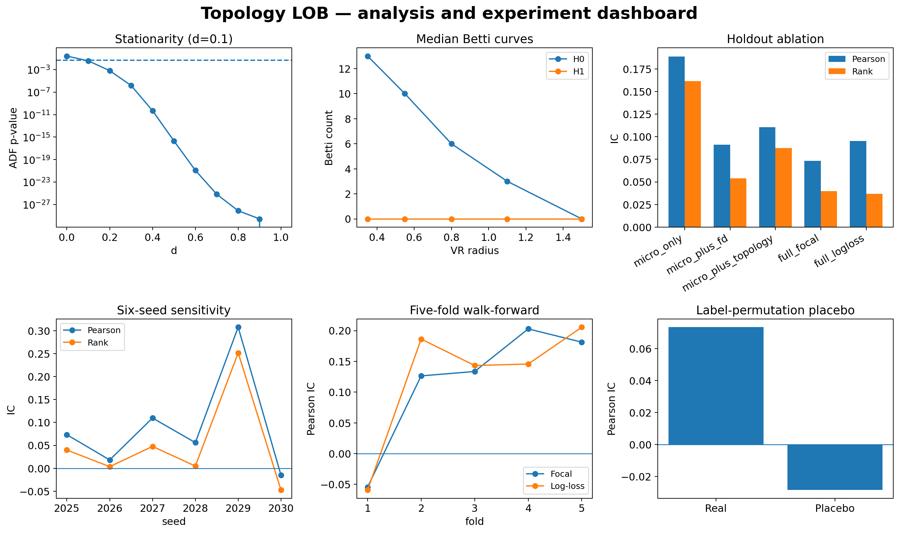
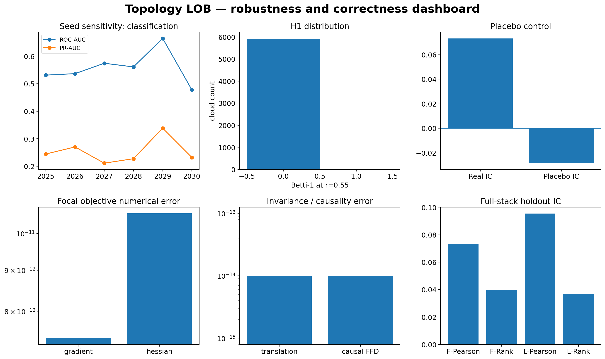
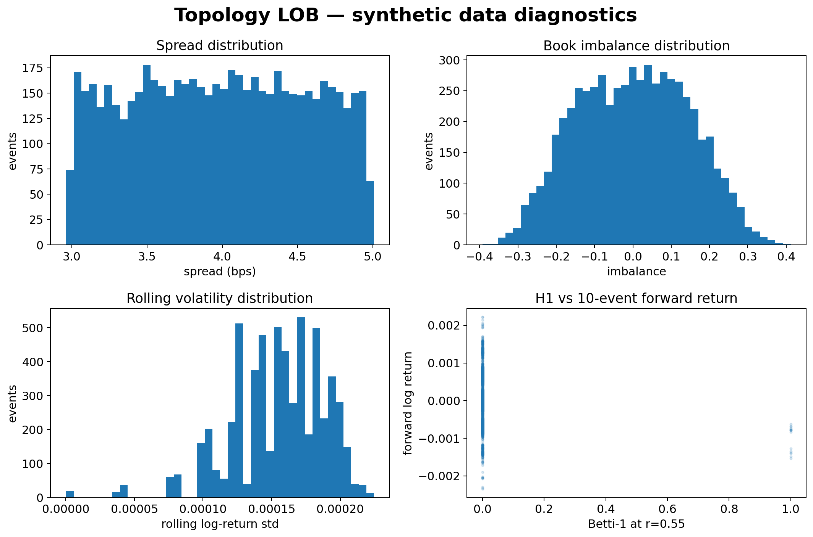
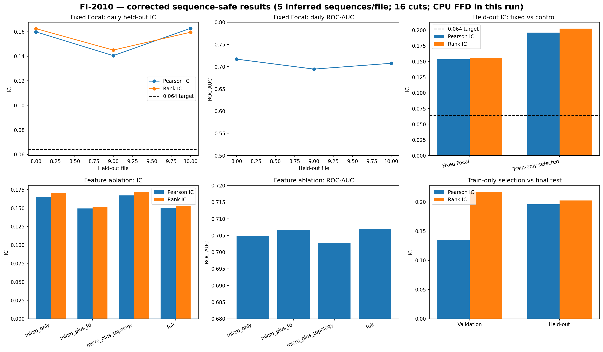

# Topology LOB

A reproducible research pipeline for Level-2 limit-order-book data. It combines liquidity-shape features, fractional differentiation, and rare-event prediction with XGBoost.

## Pipeline

1. Validate L2 snapshots, timestamps, prices, and depth sizes.
2. Build spread, imbalance, microprice, order-flow, and volatility features.
3. Turn each book snapshot into a normalized liquidity point cloud.
4. Extract H0/H1 persistent-homology and Betti-count features.
5. Select the fractional-differencing order using only the training prefix; apply the filter causally on CPU or CUDA.
6. Fit a custom binary Focal Loss XGBoost model and a standard log-loss control.
7. Score chronological held-out data after a purge gap and report Pearson IC, Rank IC, ROC-AUC, PR-AUC, and log loss.

## Current evidence

The repository separates synthetic engineering checks from market-data results. The target IC of **0.064** is a reproduction target, not a measured result for the runs below.

### Deterministic synthetic experiment

The supported CI experiment uses 6,000 generated events, a chronological holdout, a purge gap, five feature/objective variants, six random seeds, five walk-forward folds, and a label-permutation placebo. Numerical checks compare the Focal Loss gradient and Hessian against finite differences and test malformed books, price-translation invariance, and causal fractional differentiation.

The stored example produced Pearson IC **0.073292** for Focal Loss and **0.095368** for the log-loss control. These figures describe synthetic data only; they are not evidence of market alpha.

### FI-2010 benchmark

A recorded run used 254,750 training events and three held-out segments totalling 139,587 events. It evaluated 395 topology clouds with Giotto-TDA and selected fractional-differencing order **d = 0.3** using the training stream.

| Metric | Recorded result |
|---|---:|
| Pooled Pearson IC, Focal Loss | 0.002023 |
| Pooled Rank IC, Focal Loss | 0.159088 |
| Mean daily Pearson IC | 0.001864 |
| Mean daily Rank IC | 0.159976 |
| Best pooled ROC-AUC among tested variants | 0.709805 |
| Fractional-differentiation backend | CPU fallback; no CUDA device in that run |

The fixed Focal reference measured pooled Pearson IC **0.002023** and Rank IC **0.159088**. A separate leakage-aware sweep selected threshold **0.0001** and log-loss using training-only validation; on held-out data it measured Pearson IC **0.001105** and Rank IC **0.203677**. Thus, 0.064 is exceeded only if the intended metric is Rank IC—not Pearson IC. The selected validation Pearson IC of 0.1349 fell sharply to 0.0011 on the final test, so it is not an out-of-sample result. FI-2010 is a short historical benchmark, not a raw live feed, and does not establish profitability.

The updated dashboard compares Pearson IC with Rank IC, plots the 0.064 target, and shows the gap between internal validation and held-out performance. See [the full FI-2010 validation report](results/FI2010_VALIDATION.md) for segment-by-segment figures.

See the [FI-2010 validation](results/FI2010_VALIDATION.md), [synthetic experiment results](results/EXPERIMENTAL_VALIDATION.md), and [CI record](results/CI_VALIDATION.md).

## Quick start

Python 3.11 is recommended.

~~~bash
python3.11 -m venv .venv
source .venv/bin/activate
python -m pip install --upgrade pip
python -m pip install -e ".[tda,dev]"
python -m pytest -q
~~~

Run the deterministic end-to-end demo with the full Giotto-TDA backend:

~~~bash
python run.py demo --config configs/demo.json --out results/demo --require-gtda
~~~

The output includes metrics.json, test_scores.csv, Betti curves, a fractional-stationarity plot, and index.html. Add --require-cuda to require CUDA fractional differentiation; the command exits if it falls back to CPU.

Run the extended experiments and C++ benchmark:

~~~bash
python scripts/generate_evidence.py --events 6000 --out results/evidence --require-gtda
python run.py ablation --config configs/demo.json --out results/ablation
python run.py walk-forward --config configs/demo.json --out results/walk_forward.json
python run.py ffd-benchmark --events 200000 --width 256 --d 0.45
cmake -S . -B build
cmake --build build --config Release
./build/fractional_diff_cpu
~~~

## Real L2 input

The CSV loader expects one row per snapshot with a timestamp and columns for every level:

~~~text
timestamp,bid_price_1,bid_size_1,ask_price_1,ask_size_1,...,bid_price_N,bid_size_N,ask_price_N,ask_size_N
~~~

The loader sorts by timestamp and rejects duplicate or invalid timestamps, missing or non-finite values, negative sizes, invalid prices, and crossed/locked or incorrectly ordered books.

~~~bash
python run.py demo --config configs/demo.json --data /absolute/path/to/l2.csv --out results/real_l2 --require-gtda
~~~

Use raw, timestamped L2 snapshots for any claim about a live-feed result. FI-2010 uses an event index in place of exchange timestamps because its benchmark files do not provide usable wall-clock timestamps.

## FI-2010 benchmark reproduction

The fetch script downloads the public Decimal-Precision benchmark files to a local directory; dataset files are not committed. FI-2010 is CC BY 4.0; credit Ntakaris et al. (2018) and link the [official data record](https://etsin.fairdata.fi/dataset/73eb48d7-4dbc-4a10-a52a-da745b47a649) when sharing results.

~~~bash
python scripts/fetch_fi2010.py --out data/external/fi2010.zip --extract
python scripts/run_fi2010_benchmark.py \
  --train data/external/fi2010/fi2010/Train_Dst_NoAuction_DecPre_CF_7.txt \
  --test \
    data/external/fi2010/fi2010/Test_Dst_NoAuction_DecPre_CF_7.txt \
    data/external/fi2010/fi2010/Test_Dst_NoAuction_DecPre_CF_8.txt \
    data/external/fi2010/fi2010/Test_Dst_NoAuction_DecPre_CF_9.txt \
  --tda-stride 1000 --require-gtda --out results/fi2010_benchmark.json
~~~

Review the terms on the [official FI-2010 data record](https://etsin.fairdata.fi/dataset/73eb48d7-4dbc-4a10-a52a-da745b47a649) before using or redistributing the dataset. The repository stores scripts and result summaries, not raw dataset files.

### IC sensitivity experiment

The real-data workflow also runs `scripts/run_fi2010_ic_sweep.py`. It compares five return thresholds and both Focal Loss and log-loss using a chronological validation period inside the training data. Only the selected configuration is then evaluated on held-out segments. Pearson IC and Rank IC are recorded independently; the target value is never inserted into the measurements.

## Figures and reports

These images show experiment results and data analysis, not terminal captures. The report snapshot is rendered as a high-contrast raster image so its text stays readable on GitHub.

- [Experiment dashboard](assets/figures/experimental_validation_dashboard.png)
- [Robustness checks](assets/figures/robustness_dashboard.png)
- [Data diagnostics](assets/figures/data_diagnostics_dashboard.png)
- [FI-2010 results](assets/figures/fi2010_validation_dashboard.png)
- [Run-report snapshot](assets/screenshots/report_preview.png)
- [Figure notes](assets/README.md)

## Author

**Pirate-Emperor**

## License

The project code is released under the MIT License; see [LICENSE](LICENSE). Dataset terms are separate from the code license.
